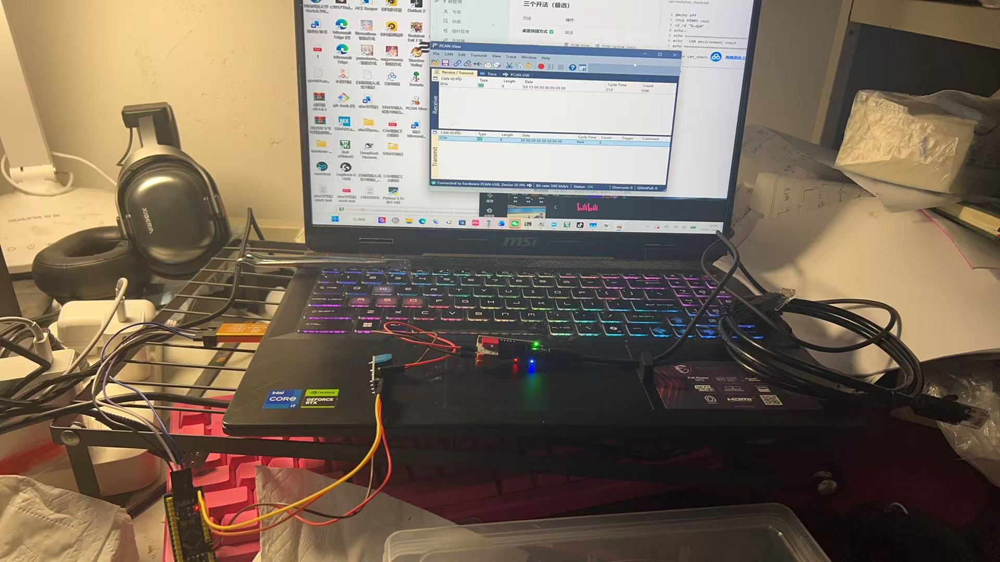
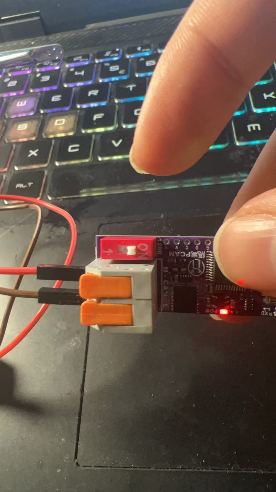
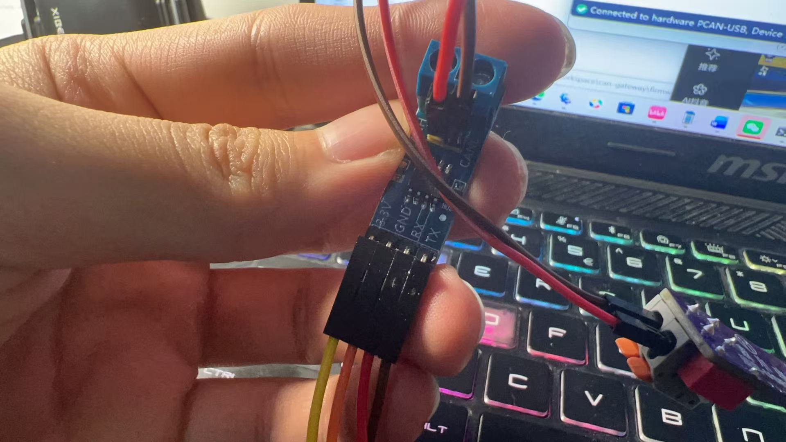
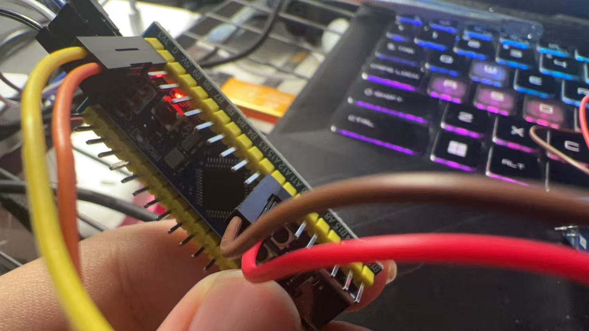

# 接线与上电检查

## 1. 收发器到 MCU

SN65HVD230 模块（3.3 V）与 STM32F103 的连接：

| 模块引脚 | 接到 | 说明 |
|---|---|---|
| VCC | 3.3 V | **不要接 5 V** |
| GND | GND | 与 MCU 共地 |
| CTX（TXD） | PA12 | CAN_TX |
| CRX（RXD） | PA11 | CAN_RX |
| CANH | 总线 CANH | |
| CANL | 总线 CANL | |

> PA11/PA12 是 F103 的 USB 引脚，同时也是默认 CAN 引脚。本项目的 MCU 只用了 CAN，没开 USB，所以不冲突。
> 如果同时用 USB，需要重映射 CAN 到 PB8/PB9（`__HAL_AFIO_REMAP_CAN1_2()`）。

## 2. 总线拓扑

```
 板 A          分析仪          板 B
┌──────┐     ┌──────┐     ┌──────┐
│CANH──┼──┬──┤CANH  ├──┬──┤──CANH│
│CANL──┼──┴──┤CANL  ├──┴──┤──CANL│
└──────┘     └──────┘     └──────┘
  [120Ω]                    [120Ω]
   末端 1                    末端 2
```

- 120 Ω 只在**最左**和**最右**各一个
- 分析仪如果在中间，它的 120R 开关要**关掉**
- 分析仪如果在末端，它的 120R 开、另一端开，共 2 个

## 3. 上电前必做（30 秒）

```
□ 断电，万用表电阻档量 CANH–CANL
   ≈ 60 Ω  → 正常
   ≈ 120 Ω → 只接了一个终端电阻
   ≈ 40 Ω  → 接了三个，多关一个
   OL      → 开路，接线断了或电阻串错了
□ 量 VCC–GND，确认没有短路
□ 确认收发器供电是 3.3 V，不是 5 V
□ 确认两块板的地是通的（不共地 = 收不到任何帧）
```

**90 % 的「CAN 不通」都在这四条里。**

## 4. 常见故障对照

| 现象 | 最可能的原因 |
|---|---|
| 完全收不到帧 | 不共地 / 120 Ω 接错 / CANH-CANL 接反 |
| 能收到但大量错误帧 | 位定时不对（尤其 BRP 错成 1 Mbps） |
| 只有一块板能发 | 缺 ACK —— 另一块板没上电或在听模式 |
| 一上电就 Bus-Off | 总线短路，或两个节点波特率不一致 |
| 偶尔丢帧，负载一高就崩 | 终端电阻缺失，反射导致误码 |
| `TEC` 缓慢上涨 | 线太长 / 没双绞 / 收发器供电不稳 |

## 5. 线材

- 用**双绞线**（CANH/CANL 绞在一起），不要用两根分开的杜邦线拉长距离
- 台面测试 20 cm 以内影响不大，但**压测 72 h 建议换双绞线**
- 网线（超五类）拆一对出来正好：一对绞线 = CANH + CANL，另一对接地

## 6. 实拍记录

2026-11-04，第一次在 PCAN-View 上收到 `0x201` 帧当天的实物接线。

**整体**：STM32F103CBT6 + SN65HVD230 + PCAN-USB 分析仪



**分析仪端子**：红色 `120R` 开关拨在 ON 一侧



**收发器模块**：丝印 `3.3V / GND / RX / TX`



**MCU 侧**：PA12 → 模块 `TX`，PA11 → 模块 `RX`，3V3 → `3.3V`，GND → `GND`



> 命名容易搞混：模块上的 `TX/RX` 是收发器自己的 TXD（输入）/ RXD（输出），
> 所以 MCU 的 `CAN_TX`(PA12) 接模块 `TX`、`CAN_RX`(PA11) 接模块 `RX`，
> **同名对同名，不交叉**。交叉是 UART 的习惯，CAN 收发器不适用。
